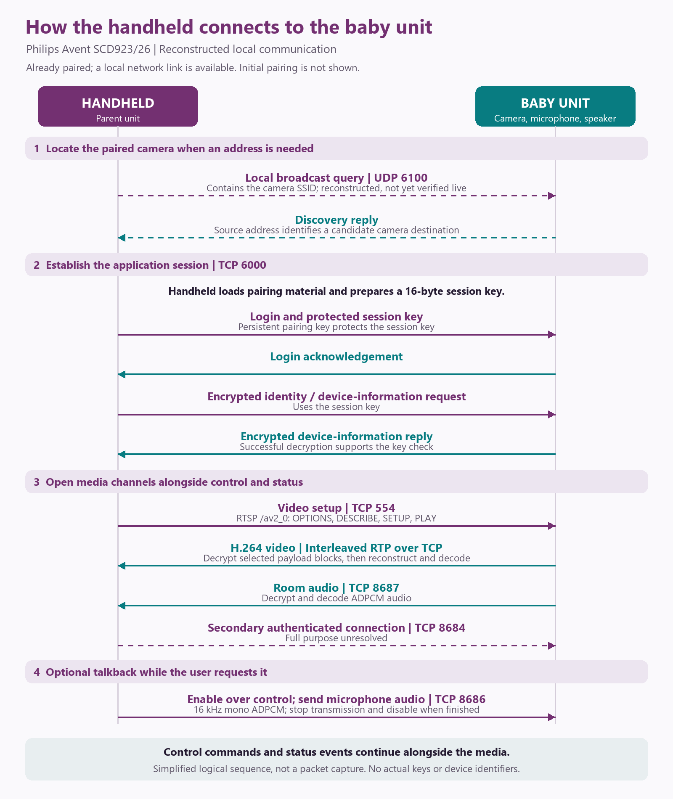
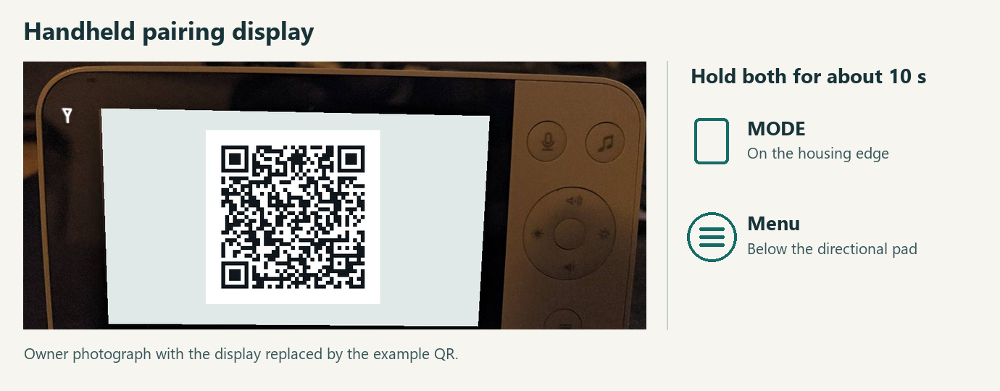
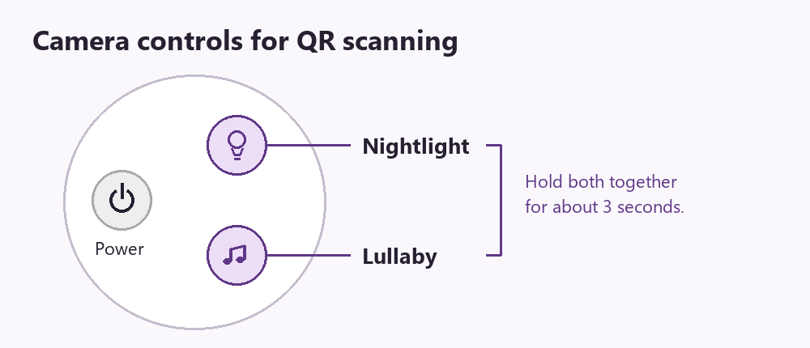

# Philips Avent Baby Monitors: Local Protocols and QR Pairing

*Interoperability research on SCD923/26 and additional models*

Independent interoperability research · Revised 5 November 2026

This paper investigates local protocols and QR pairing in Philips Avent baby monitors. The findings documented below describe how the SCD923/26 pairs over Wi-Fi, establishes an encrypted local session and streams video over RTSP. The companion repository includes the integration and its installation guide: [Avent local for Home Assistant](https://github.com/H3adsho0ot/ha-local-babyphone).

**Model scope.** Local interoperability has been tested on the SCD923/26. Contributor reports for the SCD973 show substantial overlap, including the physical QR-pairing procedure, alongside differences in the QR contents and session establishment. These reports are attributed below and have not been independently verified on an SCD973 by this project. Successful SCD973 authentication with the independent client remains unconfirmed. Unless explicitly stated otherwise, the technical findings below apply to the examined SCD923/26 setup.

**Private contributions.** Have findings, network captures, firmware files or dumps to contribute privately? Contact me on Discord to arrange sharing. Please do not attach sensitive files to public GitHub issues.

## Abstract

The SCD923/26 supports a local connection between its handheld parent unit and baby unit. Examination of a user-owned handheld's firmware, followed by an independent client implementation, enabled live video, room audio, intelligible talkback and device controls without a manufacturer account in the tested local setup. The connection combines proprietary session establishment with RTSP video and separate audio channels. A normal RTSP player cannot reproduce the complete exchange on its own.

The handheld can display a QR code containing a newly generated direct Wi-Fi network name and 16-character password. On one SCD923/26 set, the owner put the handheld in direct-only mode before generating the code, put the baby unit into scan mode and showed it the handheld display. The handheld reconnected. Across the pairing attempts, the owner also reported that Home Assistant needed the new key. The handheld's firmware explains why the camera can accept a key before the handheld saves it.

## Method and evidence

The investigation combined analysis of the handheld application, offline protocol comparisons and local interoperability tests against the paired baby unit. Isolated ARM emulation exercised the handheld's button, Wi-Fi and pairing routines with synthetic credentials. The emulator intercepted network access and file writes. Physical observations come from the owner's pairing attempts and photographs of both units.

Evidence is distinguished below as **observed** for behavior exercised on the examined SCD923/26, **reconstructed** for behavior inferred from its handheld firmware, **contributor-reported** for external device observations not independently verified by this project, and **unresolved** where the available evidence is insufficient. The diagram is a reconstruction of the original SCD923/26 handheld's logical exchange, not a captured packet trace. Initial pairing and Wi-Fi provisioning are outside its scope.

## Handheld connection sequence

The handheld loads its stored pairing material and prepares a 16-byte session key. It sends the session key protected by the pairing key over the control connection, then exchanges encrypted identity and device information. A login acknowledgement alone is insufficient to demonstrate that the key is correct; successfully decrypting a meaningful device-information reply provides a stronger interoperability check.

The media connections run alongside the control session. Video arrives as H.264 over RTP interleaved in a TCP RTSP connection. Selected blocks within video payloads are encrypted. The receiver must decrypt those blocks before reconstructing and decoding the H.264 stream. Room audio and talkback use ADPCM with their own framing and encryption handling.

| Channel | Transport | Role and evidence |
| --- | --- | --- |
| Discovery | UDP 6100 | Broadcast query containing the paired camera's SSID. Reconstructed and tested with simulated replies. Live PC queries received no reply. |
| Control | TCP 6000 | Session establishment, commands, replies and status events; observed |
| Video | TCP 554 | RTSP endpoint `/av2_0`, carrying H.264 over interleaved RTP; observed |
| Room audio | TCP 8687 | Separate incoming audio connection in the tested setup; observed |
| Talkback | TCP 8686 | Microphone audio sent to the baby unit; observed |
| Secondary connection | TCP 8684 | Additional authenticated exchange; reproduced, but its complete purpose remains unresolved |

Discovery is reconstructed as a UDP query to the local broadcast address. The handheld uses the reply's source address to update its camera destination before the pairing-key exchange. Live queries from a PC yielded no response with either automatic interface selection or an explicit Ethernet binding. Rediscovery after an address change remains unverified.

## Pairing material and encryption

In the examined pair, the stored direct-Wi-Fi password also supplies the 16-byte pairing key used to protect the session key. The session key then protects application traffic. The implementation uses an AES-derived variant; treating it as an ordinary AES-ECB interface was not sufficient for interoperability.

The handheld has a separate path for **re-pairing**. It generates a new direct network name from a modified representation of the WLAN MAC address and produces a 16-character password using a clock-seeded pseudorandom generator. It uses that password to wrap the session key. The session-key generator also uses clock-seeded randomness. The analysis does not quantify entropy or demonstrate practical key prediction. The source of the original factory pairing and possible secret reuse across units remain unknown.

## Re-pairing from the handheld display

**Observed on the SCD923/26 handheld.** The owner photographed the pairing screen and identified both physical controls. Decoding the original photograph locally yielded a JSON object. Its three fields were `dev` (the handheld type, `pu`), `ssid` (the newly generated direct network name) and `passwd` (the new 16-character password). The figure uses the owner's photograph with the display replaced. Scanning the published figure returns the values in the [synthetic JSON example](examples/handheld-qr.json).

**Contributor-reported SCD973 QR format.** The SCD973 uses the fields `dev`, `si`, `pd` and `ver`. An illustrative shape with placeholders, not usable pairing data, is `{"dev":"...","si":"...","pd":"...","ver":"001"}`. The contributor reports that `pd` contains a Base64-encoded 16-byte value, rather than the SCD923/26's 16-character `passwd`. The role of that value in SCD973 session establishment remains under investigation; decoding Base64 alone does not establish compatibility with the existing client. See [SCD973 support, issue #1](https://github.com/H3adsho0ot/philips-avent-local-protocol/issues/1).

**Pairing procedure: SCD923/26 and contributor-reported SCD973**

The SCD923/26 owner reported the following physical procedure to work. SCD973 contributor [@leonardpitzu](https://github.com/leonardpitzu) [confirmed the same procedure on their set](https://github.com/H3adsho0ot/philips-avent-local-protocol/issues/1#issuecomment-6667856286): direct mode, MODE + Menu for about ten seconds, then Nightlight + Lullaby for about three seconds. This confirms the reported user-facing procedure, not identical firmware behavior or support in the independent client.

1. On the handheld, select **direct-only mode** and let it switch before opening the QR dialog. This selects the direct Wi-Fi link to the baby unit. The camera's privacy setting is a separate control.
2. From the video or mode view, hold **MODE and Menu together for about ten seconds**. MODE is the elongated edge button beside a rectangle. Menu is the round button marked ≡ below the directional pad. The QR dialog starts a new pairing attempt, which can interrupt the existing connection.
3. On the baby unit, hold **Nightlight and Lullaby together for about three seconds**, then show the QR code on the handheld display to the camera. On the SCD923/26, the setup dialog identifies an orange pulsing nightlight as the scan-ready indication, and the owner heard a confirmation tone after a scan.
4. Leave the QR dialog open while the handheld reconnects.

**SCD923/26-specific notes.** A short press of the centre **OK** button cancels a pending attempt on the examined handheld. If using the local Home Assistant integration with this model, enter the current code's `passwd` as the pairing key. The integration tests it against the camera before saving it. This instruction does not establish SCD973 support.

**SCD923/26 firmware behavior.** The state transitions and explanations below were reconstructed from the examined SCD923/26 handheld; they have not been verified for the SCD973.

| Stage | Effect on the SCD923/26 handheld |
| --- | --- |
| Dialog opens | The handheld generates new credentials, requests a switch to direct Wi-Fi if needed and starts connecting with the new values. Monitoring can therefore be interrupted as soon as the code appears. |
| Pairing succeeds | After an initial five-second delay, the dialog checks Wi-Fi reachability and whether the handheld's own control session has received device information. Once both conditions hold, the handheld requests persistent writes of the new credentials. |
| Pairing is still pending | A short press and release of **OK**, or expiry of the **five-minute** timeout, restores the old handheld credentials and starts a connection attempt with them. Reopening the dialog generates a fresh pair. |

**Why the two units can disagree.** A camera scan and a handheld save are separate events. In direct mode, the handheld pings `192.170.1.1`. Its Wi-Fi check requires at least six successful results in a window of up to fifteen. The other check depends on the handheld's own encrypted control session on TCP 6000. In an isolated test, the device-information reply (`0x8002`) set the confirmation flag even with an empty JSON object. No QR-specific acknowledgement field was needed. A successful login from Home Assistant confirms the key on the camera side only.

**Why switching to direct-only first can help.** If the QR dialog opens while the handheld is using router Wi-Fi, it requests a switch and waits about five seconds. In emulation, the dialog continued when that wait expired. A delayed switch could then write the old Wi-Fi profile over the temporary file prepared with the new credentials. This reproduces one possible cause of the earlier failed attempt. The event order on the physical handheld was not recorded. In the successful attempt the owner selected direct-only first and reported that the handheld reconnected. Persistence across a later reboot was not tested.

## Features and implementation lessons

The reconstructed controls cover the nightlight and brightness, built-in sounds and playback volume, timers, temperature reporting and alert settings, Wi-Fi reception, microphone sensitivity and talkback. The local Home Assistant integration exposes these capabilities. Version 0.5.2 removed the prototype's video-based motion detector.

Several details materially affected interoperability:

- **Session setup is stateful.** Repeating the identity/device-information setup request as a polling operation caused media connections to close in the tested setup.
- **Silence is not necessarily a fault.** Native sensitivity settings can suppress quiet room audio. Closing an apparently idle audio connection also disrupted video during development.
- **Talkback needs the correct codec state.** The reconstructed format uses 16 kHz mono audio in 40 ms blocks with an IMA ADPCM step index carried between blocks. Offline packet comparisons and a listener's confirmation of intelligible speech supported the implementation. Simultaneous listening and speaking are not yet established as reliable full-duplex operation.
- **Native clients can compete.** The handheld and the independent client interfered with one another in testing. In the installed integration, multiple Home Assistant views share one native session. Device testing confirmed that the integration releases its native connections ten seconds after the last viewer leaves. Simultaneous operation with the handheld remains unverified.
- **Privacy mode affects reachability.** Activating the native privacy setting made the baby unit unreachable on the LAN during a longer test. Remote reversal was then unavailable. It should not be presented as a harmless local display toggle.

## SCD973: shared elements and differences

The table summarizes the evidence above and the [contributor's SCD973 observations](https://github.com/H3adsho0ot/philips-avent-local-protocol/issues/1). The SCD973 column has not been independently verified by this project.

| Aspect | SCD923/26 — local research | SCD973 — contributor-reported |
| --- | --- | --- |
| Physical QR pairing | Direct mode; MODE + Menu ~10 s; Nightlight + Lullaby ~3 s | Same procedure reported |
| QR fields | `dev`, `ssid`, `passwd` | `dev`, `si`, `pd`, `ver`; `ver` is `001` |
| Pairing material in QR | `passwd`: 16-character password used as pairing key | `pd`: Base64-encoded 16-byte value; session-key handling unresolved |
| TCP service ports | 554, 6000, 8684, 8686, 8687 | Same ports reported |
| Packet framing and CRC | Reconstructed and used by the independent client | Matching framing and CRC reported |
| Video | RTSP `/av2_0`, H.264, selective payload encryption | Same endpoint and video characteristics reported |
| Session establishment | Implemented and locally tested | Additional `0x0930` / `0x0931` messages; authentication requirements unresolved |
| Avent local compatibility | Working local integration on the tested set | Successful authentication with the independent client not confirmed |

**Contributor-reported; investigation ongoing.** The [SCD973 report](https://github.com/H3adsho0ot/philips-avent-local-protocol/issues/1) describes overlap in the service ports, packet framing and CRC, the RTSP `/av2_0` endpoint, and selective video encryption. The physical pairing procedure also matches, as described above. The SCD973 nevertheless does not behave identically: its QR schema differs, and the reported login exchange includes a different trailer and incoming messages `0x0930` and `0x0931`.

The contributor's diagnostic runs observed these additional messages with both login profiles, without establishing authentication. Their precise role, the cipher and key handling, and the requirements for a working independent session remain unresolved. A challenge-response mechanism is a hypothesis, not an established result. More detailed findings will be added to this paper as they are clarified and verified.

Thank you to [@leonardpitzu](https://github.com/leonardpitzu), who opened issue #1, shared the SCD973 observations and diagnostic results, confirmed the pairing procedure, and permitted their inclusion with attribution. Private captures and pairing secrets are excluded from this publication.

## Scope and open questions

The local path worked without a manufacturer account or cloud connection being used by the independent client. This does not characterize every network connection made by the product or replace an audit of its cloud services.

Further work should establish discovery behavior on real networks, compatibility across firmware revisions, the purpose of the secondary connection, full-duplex audio behavior, and the conditions under which multiple native clients can coexist. Firmware-update distribution and the original provisioning of pairing secrets are outside the confirmed results.

On the tested set, the owner could obtain fresh pairing material from the handheld display and reconnect the units using their physical controls.

## Legal notice

This is independent interoperability research for educational and informational purposes. It is not affiliated with, endorsed by, or sponsored by Philips or any other product manufacturer. Philips, Avent and other product names are trademarks of their respective owners and are used only to identify the equipment discussed.

The publication includes original explanatory text and diagrams, an owner-supplied photograph with a substituted display, independently drawn button symbols and synthetic example data. It does not distribute manufacturer firmware, manufacturer source code, extracted artwork, actual device credentials or recovered cryptographic keys. No rights to third-party software, trademarks or other protected material are granted by this publication.

Any implementation or testing based on these findings must be limited to equipment and networks that you own or are authorized to access, and must comply with applicable law and third-party rights. This publication does not authorize access to another person's devices or communications.

The findings are provided as is, without warranties of accuracy, completeness, compatibility, security or fitness for a particular purpose, to the extent permitted by applicable law. Experimental integrations should not be relied upon as the sole means of monitoring a child or for any safety-critical purpose.
